<!-- Header Animasi GIF -->

 
Video by <a href="https://pixabay.com/users/free24h-42809302/?utm_source=link-attribution&utm_medium=referral&utm_campaign=video&utm_content=205733">FREE24h</a> from <a href="https://pixabay.com//?utm_source=link-attribution&utm_medium=referral&utm_campaign=video&utm_content=205733">Pixabay</a>

# ⛩️ Kon'nichiwa, I'm Egyanta Bareka! 👋

### 📊 Applied Data Science Student | 🌸 Anime & Tech Enthusiast

*“Data is like raw code in the Matrix; you just need the right algorithms to see the truth.”*

---

### 🌸 About Me:
- 🎓 Currently pursuing **Applied Data Science** at Politeknik Elektronika Negeri Surabaya (PENS).
- 🎌 Combining my passion for Machine Learning, Data Engineering, and Japanese culture.
- 🔭 Currently building exciting AI projects and scalable data pipelines.
- ⚡ **Fun Fact:** When I'm not training ML models, I'm probably watching anime, studying Japanese (JLPT), or optimizing my Linux desktop!

---

### ⚔️ My Arsenal (Expertise & Tech Stack):

> *Here is the core magic behind my projects:*

- **⚙️ Data Engineering:** ETL pipeline design, data warehousing, SQL optimization, and real-time streaming (Kafka, Airflow, Spark).
- **🧩 AI & Machine Learning:** Deep learning (TensorFlow, PyTorch), NLP, Computer Vision, and Model Deployment (FastAPI, Flask).
- **🧠 MLOps & DevOps:** Docker, CI/CD, versioning models, and cloud orchestration with GCP or AWS.
- **📊 Data Visualization:** Interactive dashboards (Power BI, Looker Studio, Plotly Dash).

**💻 Languages:** Python, SQL, R, Bash  
**📦 Data Tools:** Airflow, Kafka, dbt, Spark, Postgres, BigQuery  
**🤖 AI Tools:** PyTorch, TensorFlow, Scikit-learn, HuggingFace, OpenAI API  
**☁️ DevOps:** Docker, Kubernetes, GitHub Actions, GCP, AWS  
**📈 Visualization:** Looker Studio, Plotly, Streamlit, Tableau  

 

  
**Technologies I Work With:** 

 

 

---

### 🌟 GitHub Stats:

  
   
  

 

### 🌸 Sakura Contributions:

  <!-- Menampilkan animasi SVG Bunga Sakura hasil generate dari GitHub Actions -->
  

 

  

